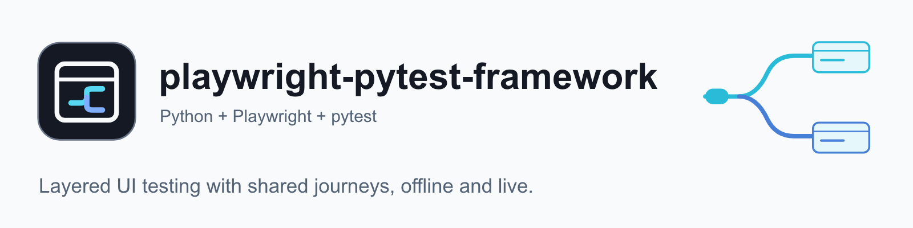
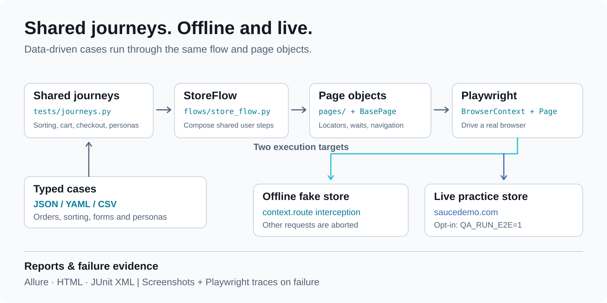
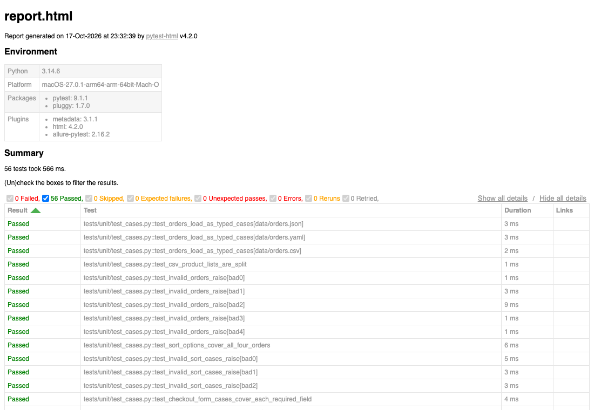

<div align="center">

<picture>
  <source media="(prefers-color-scheme: dark)" srcset="docs/assets/banner-dark.png">
  <source media="(prefers-color-scheme: light)" srcset="docs/assets/banner-light.png">
  
</picture>

### Write each user journey once. Run it offline and live.

[](https://github.com/lemun/playwright-pytest-framework/actions/workflows/ci.yml)
[](pyproject.toml)
[](pyproject.toml)
[](LICENSE)

[Quick start](#quick-start) · [How it works](#how-it-works) · [Journeys](#the-journeys) · [Reports](#running-tests-and-reports) · [Configuration](#configuration) · [Your own site](#using-this-for-your-own-site) · [CI](#ci)

</div>

A layered UI test framework in **Python + Playwright + pytest**: Page Object
Model, user journeys written once and run against two targets, typed layered
configuration, data-driven cases (JSON / YAML / CSV), Allure + HTML + JUnit
reporting, and a fast **offline integration layer** that drives the real page
objects in a real browser against a local fake store.

<p align="center">
  
  <br>
  <sub>The unit layer running (no browser needed), then the offline integration tests being collected.
  <a href="docs/assets/tests-demo.mp4">Watch the MP4</a>.</sub>
</p>

## Why

UI suites rot when every test re-implements the same clicks and when the only way to run them is against a
live site. This framework keeps three things separate:

- **Journeys are written once.** Each journey is a function in
  [`tests/journeys.py`](tests/journeys.py) that takes a `StoreFlow` and one data-driven case. The offline and
  live suites call the same functions with the same data.
- **Selectors live in page objects only.** Tests never touch a locator; each element is an ordered
  fallback chain, stable `data-test` hook first.
- **Most of the suite needs no internet.** The integration layer drives the real page objects in a real
  browser against a local fake store served through request interception, so it is deterministic and offline.
  The live run against the real site is opt-in.

The live target is [saucedemo.com](https://www.saucedemo.com), Sauce Labs'
public practice store built for UI-automation demos.

## Quick start

Requires Python 3.11+ and [uv](https://docs.astral.sh/uv/).

```bash
uv sync                                    # create .venv from uv.lock (runtime + dev tools)
uv run playwright install chromium         # browser for the integration and e2e layers
uv run pytest                              # unit + offline integration; live e2e is skipped
QA_RUN_E2E=1 uv run pytest -m e2e          # live e2e against saucedemo.com (needs internet)
```

Without uv: `python -m venv .venv && . .venv/bin/activate && pip install -e .`,
then the same `playwright install` / `pytest` commands without `uv run`.

## How it works

<picture>
  <source media="(prefers-color-scheme: dark)" srcset="docs/assets/how-it-works-dark.svg">
  <source media="(prefers-color-scheme: light)" srcset="docs/assets/how-it-works.svg">
  
</picture>

Dependencies point one way: tests → journeys → flow → pages → `BasePage` →
Playwright; config, models and utils are leaves.

```text
src/qa_framework/
├── config/settings.py      typed, immutable settings: config.yaml → profile → env vars
├── core/browser_factory.py builds Browser / BrowserContext from Settings
├── pages/                  Page Object Model, one class per page, all extend BasePage
│   ├── base_page.py          navigation, resilient locator chains, reporting
│   ├── login_page.py         navbar.py (header component)
│   ├── inventory_page.py     item_page.py   cart_page.py   checkout_page.py
├── flows/store_flow.py     the page objects of one page, composed into shared steps
│                           (log in, add products, check out, verify an order)
├── models/                 CatalogItem, OrderSummary and the case models (validation lives here)
└── utils/                  Decimal price parsing, JSON/YAML/CSV loader, Allure reporter
config/config.yaml          base config + profiles (local, ci) + the store's tax rate
data/                       orders.{json,yaml,csv}, sort_options, checkout_form_cases,
                            personas, login_cases (YAML)
tests/journeys.py           the user journeys, shared by the offline and live suites
conftest.py                 fixtures settings → playwright → browser → context → page → flow,
                            e2e gating, failure screenshots + traces
```

Design notes (resilient locators, verified actions, independent oracles, `Decimal` money, typed
data-driven cases) are in [docs/design.md](docs/design.md).

### The offline fake store

The fake store ([`tests/integration/fake_store.py`](tests/integration/fake_store.py))
is served through Playwright request interception (`context.route`), and every
other request is aborted, so the integration layer is deterministic and offline.
It reproduces only what the page objects rely on: the real app's `data-test`
hooks, login rules and messages, a `localStorage` cart, the sort options, the
checkout form's messages, the overview totals with 8% tax, and the documented
defects of `problem_user`, `performance_glitch_user` and `error_user`. Two knobs
(an inflated item total, a different tax rate) prove that the order-total check
fails when the overview is wrong, and the faulty accounts prove that a silently
dropped add is reported rather than assumed.

## Features

- **Page Object Model** with resilient, ordered locator chains and verified actions (an add is reported
  only when the card's button flips to "Remove").
- **Shared journeys** run against the fake store and the live site from one definition.
- **Data-driven, typed cases** from JSON, YAML or CSV, validated once when loaded.
- **Layered configuration**: `config.yaml` → profile (`local`, `ci`) → environment variables, strict
  booleans so a typo fails loudly.
- **Independent oracles**: expected prices come from the catalogue, not from the page being checked;
  money is `Decimal`.
- **Failure evidence**: full-page screenshot and Playwright trace attached on failure.
- **Three report formats**: Allure, self-contained HTML and JUnit XML.
- **CI** with lint, types, and the unit + offline layers on Python 3.11 and 3.14.

## The journeys

| Journey | What it proves | Data |
|---|---|---|
| Catalogue sorting | each of the four sort options orders the *rendered* list by name or price, without adding or dropping products, and the store shows the chosen option | `data/sort_options.yaml` |
| Cart persistence | added products stay in the cart across the detail page, the cart page, a reload and back in the catalogue | `data/orders.{json,yaml,csv}` |
| Removal | removing from a catalogue card and from the cart page updates the cart, the badge and the card buttons | |
| Checkout form | every required field has its own error message, and only a complete form reaches the overview | `data/checkout_form_cases.yaml` |
| Order total | the overview lists exactly the ordered products, item total = sum of the catalogue prices, tax = 8% rounded to the cent, total = item total + tax; then the order is placed | `data/orders.{json,yaml,csv}` |
| Personas | the store's practice accounts behave as documented: `problem_user` cannot sort or check out, `performance_glitch_user` is slow but correct | `data/personas.yaml` |
| Login | the login matrix (valid, locked out, wrong password, missing fields) and logout | `data/login_cases.yaml` |

### Test layers

| Layer | Where | Needs | Default `pytest` |
|---|---|---|---|
| **Unit** | `tests/unit/`: price parsing, data loading, case models, config layering | nothing | runs |
| **Integration** | `tests/integration/`: the journeys and the page objects vs. the fake store | headless Chromium, **no network** | runs |
| **E2E** | `tests/e2e/`: the same journeys + the login matrix on saucedemo.com | browser + internet | skipped unless `QA_RUN_E2E=1` |

Each journey is a function in [`tests/journeys.py`](tests/journeys.py) that takes
a `StoreFlow` and one data-driven case. `tests/integration/test_journeys_offline.py`
runs every journey against the fake store and `tests/e2e/test_journeys_e2e.py`
runs the same functions with the same data against the live site.

The fake store ([`tests/integration/fake_store.py`](tests/integration/fake_store.py))
is served through Playwright request interception (`context.route`), and every
other request is aborted, so the integration layer is deterministic and offline.
It reproduces only what the page objects rely on: the real app's `data-test`
hooks, login rules and messages, a `localStorage` cart, the sort options, the
checkout form's messages, the overview totals with 8% tax, and the documented
defects of `problem_user`, `performance_glitch_user` and `error_user`. Two knobs
(an inflated item total, a different tax rate) prove that the order-total check
fails when the overview is wrong, and the faulty accounts prove that a silently
dropped add is reported rather than assumed.

## Running tests and reports

Besides the quick start, these variants are supported:

```bash
QA_RUN_E2E=1 QA_HEADLESS=false QA_SLOWMO_MS=300 uv run pytest -m e2e   # watch it in a real window
QA_RUN_E2E=1 QA_BROWSER=firefox uv run pytest -m e2e                   # other engine (install it first)
QA_ORDERS=data/orders.csv QA_RUN_E2E=1 uv run pytest -m e2e -k order_total     # orders from the CSV file
QA_PROFILE=ci uv run pytest                                            # longer timeouts
uv run pytest -m smoke                                                 # quick subset
```

Every run writes to `reports/` (gitignored):

| Format | Location | View |
|---|---|---|
| Allure | `reports/allure-results/` | `allure serve reports/allure-results` (needs the Allure CLI and Java) |
| HTML | `reports/html/report.html` | open in a browser |
| JUnit XML | `reports/junit/results.xml` | any CI |

<p align="center">
  
  <br>
  <sub>The HTML report of a unit-layer run.</sub>
</p>

Journeys attach screenshots, the measured login time and an "order-summary"
(lines, amounts, expected values) to Allure. On failure the
full-page screenshot and the Playwright trace are attached too (open a trace
with `uv run playwright show-trace <trace.zip>`). CI uploads `reports/` as a
build artifact.

## Using this for your own site

The framework layers (settings, browser factory, `BasePage`, reporting, fixtures, data loader) are generic.
The saucedemo parts are the page objects, the flow, the journeys, the data files and the fake store.

1. Set `QA_BASE_URL` (or `base_url` in `config/config.yaml`) to your site.
2. Replace the classes in `src/qa_framework/pages/` with your own, extending `BasePage`, and compose them in
   `src/qa_framework/flows/`. Keep selectors inside page classes only.
3. Rewrite `tests/journeys.py` and the files in `data/` for your user journeys. Case models live in
   `src/qa_framework/models/`.
4. The offline layer is optional. If you do not want a fake store, delete `tests/integration/` and keep the unit
   and e2e layers.
5. Run `uv run pytest` for the offline layers, then `QA_RUN_E2E=1 uv run pytest -m e2e` against your site.

## Configuration

`config/config.yaml` holds the defaults and the `local` / `ci` profiles.
Environment variables (or a `.env` file, see [`.env.example`](.env.example))
override them:

| Variable | Default | Purpose |
|---|---|---|
| `QA_RUN_E2E` | unset | `1` enables the live e2e tests |
| `QA_PROFILE` | `local` | config profile |
| `QA_BASE_URL` | `https://www.saucedemo.com` | target site |
| `QA_BROWSER` | `chromium` | `chromium` / `firefox` / `webkit` |
| `QA_HEADLESS` | `true` | strict boolean; a typo fails loudly |
| `QA_SLOWMO_MS` | `0` | slow motion for demos |
| `QA_USERNAME` / `QA_PASSWORD` | the store's published practice account | login |
| `QA_ORDERS` | `data/orders.json` | order cases for the cart and order-total journeys |
| `QA_TIMEOUT_DEFAULT_MS` / `QA_TIMEOUT_NAV_MS` | `10000` / `30000` | timeouts |

The credentials in `config/config.yaml` and `data/login_cases.yaml` are the
practice accounts saucedemo.com prints on its own login page; they are not secrets.

## CI

[`.github/workflows/ci.yml`](.github/workflows/ci.yml) runs ruff + mypy, then the unit and offline
integration layers on Python 3.11 and 3.14, on every push and pull request. The live e2e job against
saucedemo.com depends on a third-party site, so it runs only when you start the workflow by hand from the
Actions tab. Reports are uploaded as artifacts.

## Limitations

- The fake store is a test double that mirrors the real app's hooks and rules;
  it is not the app. The live e2e layer is what checks the real site, and it
  depends on saucedemo.com being up.
- Verified with Chromium. Firefox and WebKit are configurable but not exercised in CI.
- Price parsing assumes US-style grouping (`,` thousands, `.` decimals).
- The `performance_glitch_user` check asserts a lower bound on the login time
  (2 s; the live store blocks for about 5 s), so it can only fail when the
  documented slowdown disappears, not when the network is slow.

## Contributing

Issues and pull requests are welcome. Before opening a pull request, run what CI runs:

```bash
uv sync
uv run ruff check . && uv run ruff format --check . && uv run mypy
uv run pytest
```

## Credits

The login and header (navbar) page objects and the first login spec come from
an earlier prototype of mine, `playwright-pytest-swaglabs`, which is merged into
this repository.

## License

[MIT](LICENSE)
